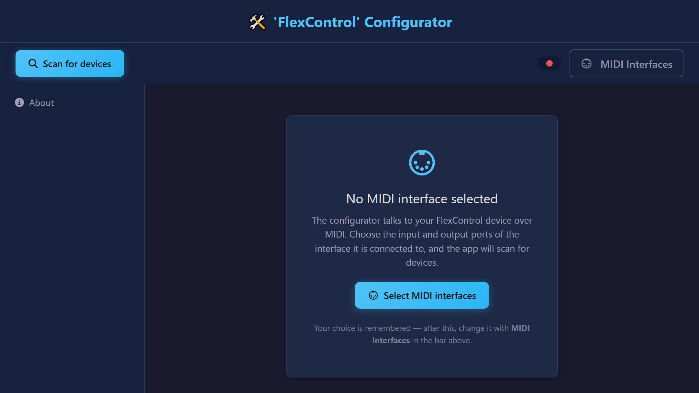
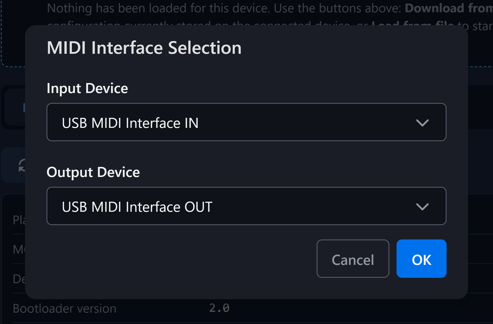
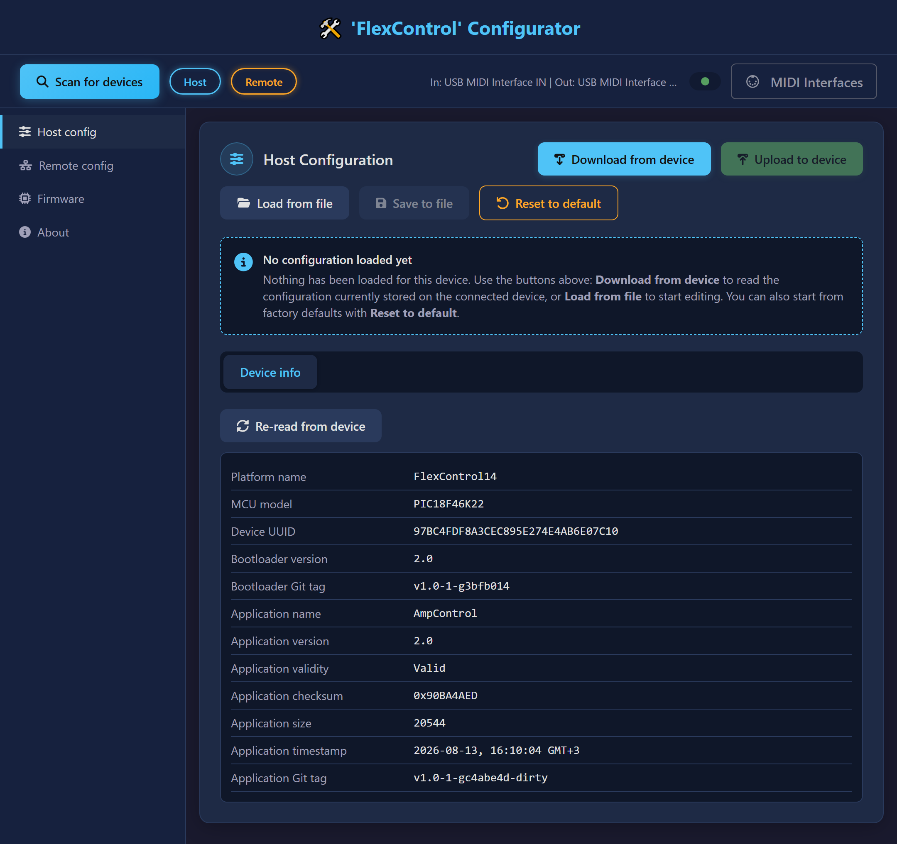
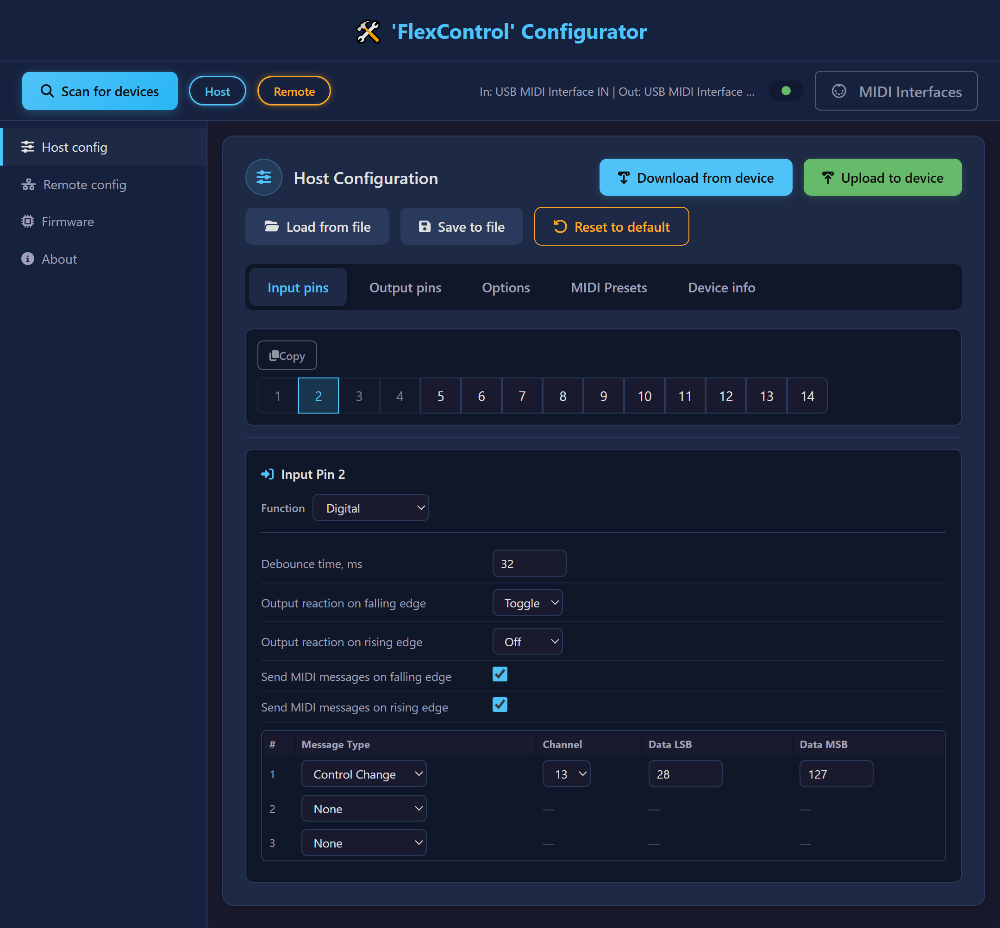
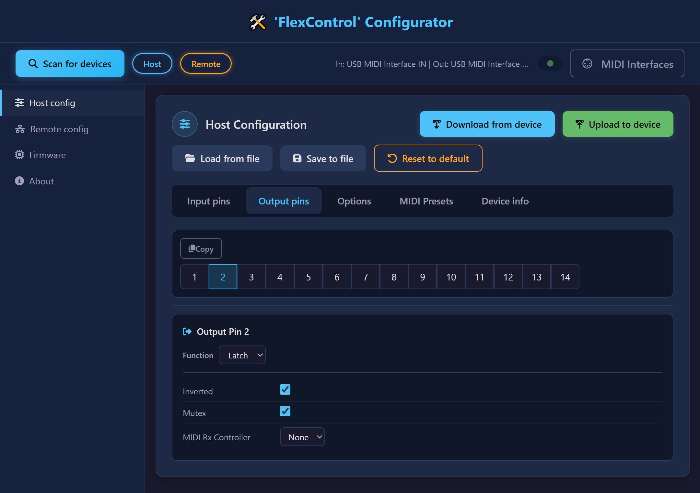
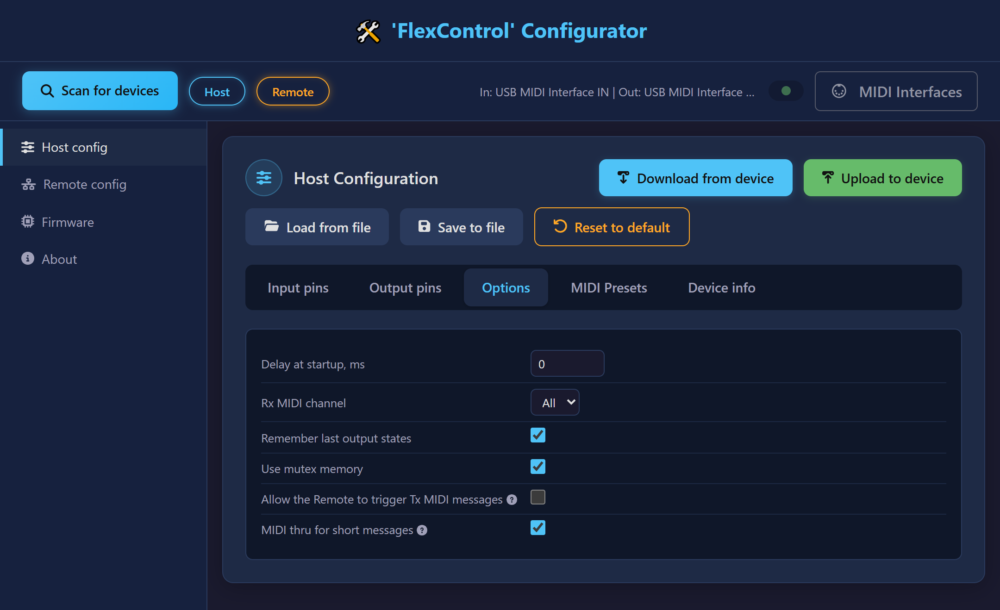
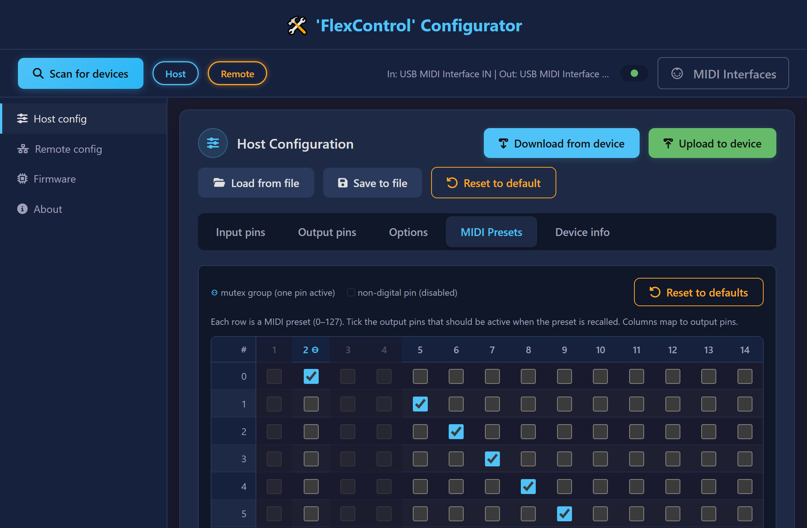
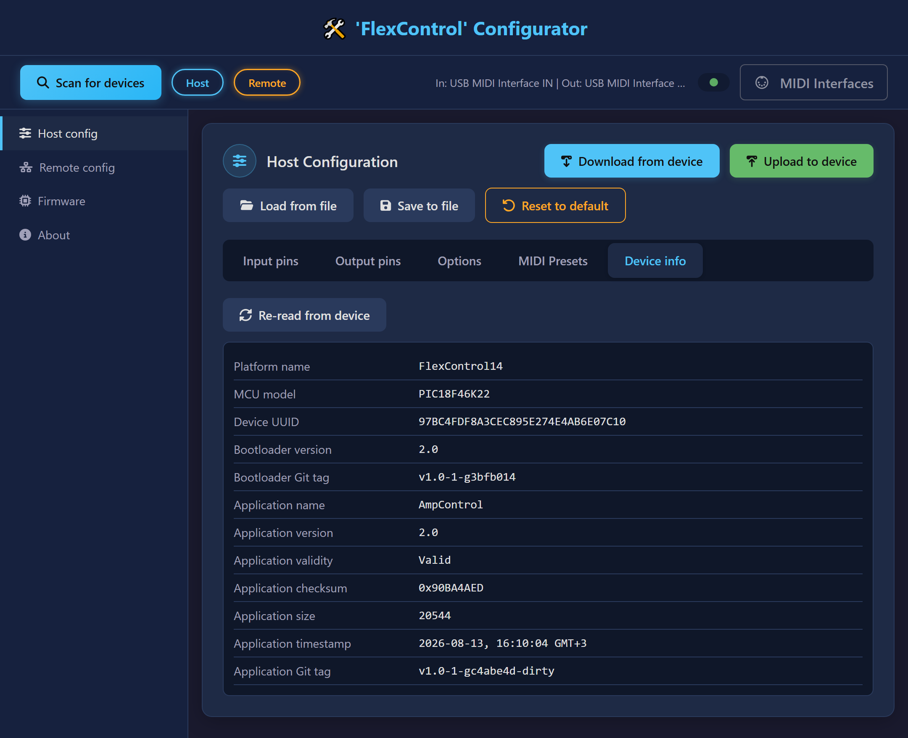
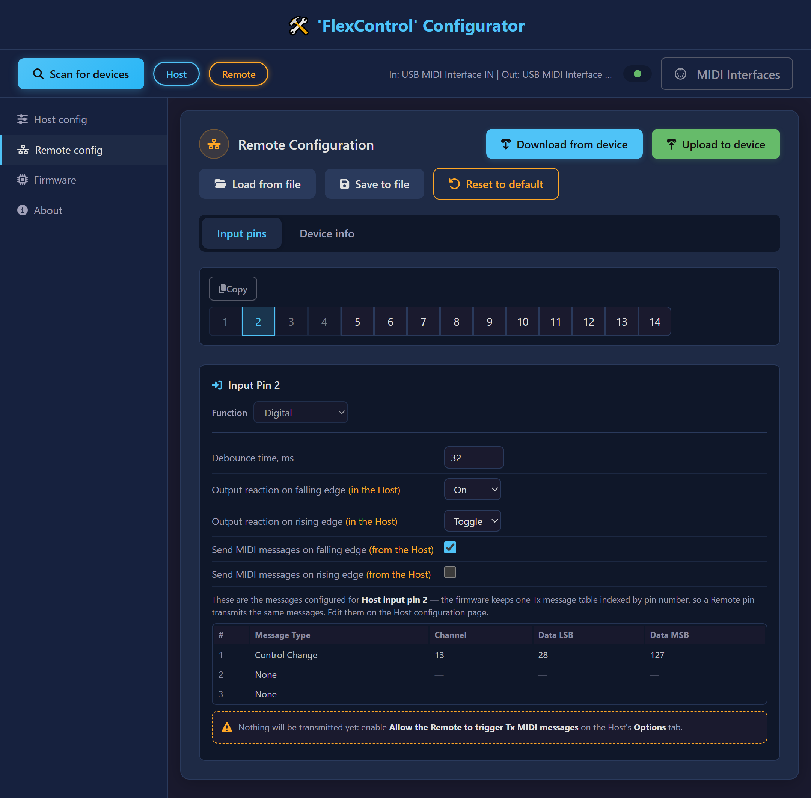
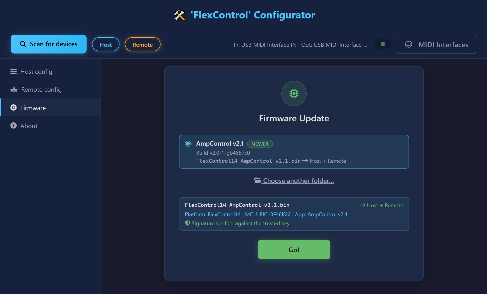

# FlexControl Web Configurator — user’s guide

## Web app URL

<https://kaladim.github.io/flexcontrol-web-configurator-public/>

## About

This web application is for detailed configuration of the [`FlexControl 14`](https://github.com/kaladim/flexcontrol-public), a multi-purpose MIDI controller and decoder. Nothing has to be installed — it runs entirely in the browser, on Windows, macOS, Linux, Android and iOS.

On a desktop or laptop computer, use Google Chrome, Microsoft Edge, Opera, Brave or Firefox.

Safari on an iPhone or iPad does not support Web MIDI. Use one of these browsers from the App Store instead:

- [**MIDIWeb Browser**](https://midiweb.cc/)
- [**Web MIDI Browser**](https://apps.apple.com/us/app/web-midi-browser/id953846217) — a browser by Takashi Mizuhiki, built for Web MIDI applications; it also enables Bluetooth MIDI on iOS.

## Connecting to the `FlexControl 14`

- You need a USB-MIDI interface (or a sound card with a MIDI port) connected to your computer or mobile device.
- You also need two MIDI cables between the interface and the board, one in each direction:
  - interface **MIDI Out** → board **MIDI In**
  - interface **MIDI In** ← board **MIDI Out**

**Note:** Both cables must be connected, and the `FlexControl 14` must be powered on.

## Selecting the MIDI interface

Open the application. The browser asks for permission to use your MIDI devices — grant it, or the application cannot reach the board.

On the first run, no interface has been chosen yet:

Click **Select MIDI interfaces**, choose the input and output ports of your interface, then click **OK**.

The choice is stored in the browser, so later runs connect automatically. To change it, use the **MIDI Interfaces** button in the top bar.

### Finding the board

As soon as the ports are open, the application scans for devices. Every board that answers appears as a badge next to the **Scan for devices** button — **Host**, **Remote**, or both — and the indicator beside the port names turns green. If nothing is found, check the cables and the power, then click **Scan for devices** again.

The sidebar then offers one page per board, **Host config** and **Remote config**, plus **Firmware**:

### Loading and saving a configuration

The buttons at the top of a configuration page act on the configuration as a whole:

- **Download from device** — read the configuration currently stored in the board.
- **Upload to device** — write the configuration back to the board.
- **Load from file** — open a configuration saved earlier.
- **Save to file** — store the current configuration on your computer.
- **Reset to default** — replace it with the factory defaults.

The editing tabs stay hidden until a configuration is loaded, so a default is never shown as if it had been read from the board. Normally, you start with **Download from device** and edit what the board actually holds.

Some settings are read by the firmware only at startup. When an upload changes one of them, the application says so; power the board off and on again to apply it.

### Input pins

Click a pin in the numbered strip to edit it. Its parameters appear underneath, and a pin with the **Digital** function also gets a table of up to three MIDI messages to transmit.

An input pin acts only on the output pin with the same number (In 1 → Out 1, In 2 → Out 2, and so on). If that output is set to **Pulse**, the input pin has no effect on it, and the application says so instead of offering settings that would do nothing.

**Copy** stores the parameters of the selected pin. Selecting another pin then offers **Paste**, which applies them — the quickest way to give several pins the same behavior.

### Output pins

Output pins work the same way: click a pin, then edit it. The **Function** setting decides which parameters are available — **Mutex** applies only to a **Latch** output, and the pulse duration only to a **Pulse** output.

### Options

The **Options** tab holds the settings that apply to the whole board rather than to a single pin:

- **Delay at startup, ms** — the board does not switch its outputs for this long after power-up. Useful when a tube amplifier has to warm up first.
- **Rx MIDI channel** — the MIDI channel the board listens on, or **All**.
- **Remember last output states** — start with the output states the board had when it was last powered off.
- **Use mutex memory** — memorize the states of the non-mutex outputs for the active mutex output, and restore them when that mutex output becomes active again.
- **Allow the Remote to trigger Tx MIDI messages** — let an edge on a Remote input pin make the Host transmit the messages configured for the Host input pin with the same number. The Host’s own input pins take precedence.
- **MIDI thru for short messages** — the Host passes every short MIDI message it receives on its MIDI In to its MIDI Out, unchanged, so a device connected after the `FlexControl 14` still receives the messages your controller sends. Channel messages are passed on only when they match the **Rx MIDI channel**; **MIDI Rx inhibit** inputs do not stop them. System Exclusive (SysEx) messages are never passed on.

### MIDI Presets

A MIDI preset is a set of output states recalled by an incoming ‘Program Change’ message. Each of the 128 rows is one preset; tick the outputs that should be active when it is recalled.

Columns for pins in the mutex group are marked, and only one of them can be ticked per row. Columns for pins that are not **Latch** outputs are disabled.

### Device info

The **Device info** tab identifies the board: its platform and microcontroller, its unique ID, and the versions of its bootloader and application. Quote these values when asking for support.

### Configuring the Remote

A Remote board has its own page, with fewer settings. The Remote reports raw pin edges to the Host, and the Host decides what they mean, so the pin function and the MIDI messages are shown read-only here and are edited on the Host page. What you set on the Remote page is the reaction that each of its pins triggers in the Host.

For a Remote pin to transmit MIDI, **Allow the Remote to trigger Tx MIDI messages** must also be enabled on the Host’s **Options** tab.

### Complete parameter list

#### Input pins

| Function | Parameter | Description |
| --- | --- | --- |
| **Digital** | Debounce time, ms | How long the pin level must stay stable before a change is accepted. This filters out the contact bounce of most switches and buttons. The value is shared by all digital inputs. Values above 100 ms add a noticeable delay to the reaction. |
| **Digital** | Output reaction on falling edge | What the output pin with the same number does when the voltage on this pin goes from 5 V to 0 V: None, Off, On or Toggle. |
| **Digital** | Output reaction on rising edge | The same, for a transition from 0 V to 5 V. |
| **Digital** | Send MIDI messages on falling edge | Transmit this pin’s MIDI messages when the voltage goes from 5 V to 0 V. |
| **Digital** | Send MIDI messages on rising edge | Transmit this pin’s MIDI messages when the voltage goes from 0 V to 5 V. |
| **Digital** | MIDI message table | Up to three short MIDI messages to transmit, each with its own type, channel and data bytes. Only the data bytes that the chosen message type actually uses can be edited. |
| **MIDI Rx inhibit** | Inhibit level | The level at which the pin blocks MIDI reception: Low or High. While the pin is at that level, incoming MIDI messages are ignored. The value is shared by all pins with this function. |
| **MIDI Rx inhibit** | Debounce time, ms | As above — one value for all digital inputs. |

#### Output pins

| Function | Parameter | Description |
| --- | --- | --- |
| **Latch** | Inverted | Inverts the active level of the output pin. |
| **Latch** | Mutex | Puts the pin in the mutually exclusive group: when it turns on, every other pin in the group turns off. A group needs at least two pins. |
| **Latch** | MIDI Rx Controller | The ‘Control Change’ number this output reacts to, or None. |
| **Pulse** | Inverted | Inverts the active level of the output pin. |
| **Pulse** | Pulse duration, ms | How long the pulse lasts. The value is shared by all pulse outputs. |

#### Suggested input pin configuration, by type of connected switch

| Class | Type | Desired output interdependence | Edge | Output reaction |
| --- | --- | --- | --- | --- |
| Non-retentive (momentary) | Pushbutton | Mutex | ↓ | On |
| Non-retentive (momentary) | Pushbutton | Mutex | ↑ | None |
| Non-retentive (momentary) | Pushbutton | None | ↓ | Toggle |
| Non-retentive (momentary) | Pushbutton | None | ↑ | None |
| Retentive | Switch (visible state) | None | ↓ | On |
| Retentive | Switch (visible state) | None | ↑ | Off |
| Retentive | Switch (invisible state) | None | ↓ | Toggle |
| Retentive | Switch (invisible state) | None | ↑ | Toggle |
| Retentive | Switch (invisible state) | Mutex | ↓ | On |
| Retentive | Switch (invisible state) | Mutex | ↑ | On |
| Retentive | Rotary switch | Mutex | ↓ | On |
| Retentive | Rotary switch | Mutex | ↑ | None |

↓ = falling edge, ↑ = rising edge

## Updating the firmware

1. Click **Firmware** in the sidebar and select an available firmware version.
5. Click **Go!** and wait for the update to finish.

